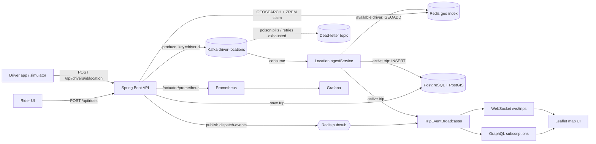

# Ride-Hailing / Delivery Tracking

[](https://github.com/Ashishk9670/ride-hailing-tracking/actions/workflows/ci.yml)
[](https://github.com/Ashishk9670/ride-hailing-tracking/actions/workflows/codeql.yml)
[](https://github.com/Ashishk9670/ride-hailing-tracking/actions/workflows/trivy.yml)
 

Spring Boot 3.5 (Java 21, Maven) reference implementation of real-time driver matching and live trip tracking.

## Architecture



Text sketch of the same flow:

```
 driver app / simulator
        | POST /api/drivers/{id}/location        (REST)
        v
  Kafka topic  driver-locations  (key = driverId, 3 partitions)      <- location firehose
        |
        v   @KafkaListener  (LocationIngestService)
  +--------------------------+--------------------------------------------+
  | driver has no active trip| driver has an active trip (Redis registry)  |
  | GEOADD drivers:available | INSERT PostGIS location_history             |
  | (available-driver index) | + push to TripEventBroadcaster              |
  +--------------------------+--------------------------------------------+
                                        |
        +-------------------------------+-----------------------+
        v                                                       v
  GraphQL subscription  tripLocation/tripStatus       raw WebSocket /ws/trips/{tripId}
  (Spring GraphQL over WebSocket, /graphql)            (used by the Leaflet map UI)

 POST /api/rides -> TripService:  save Trip (PostGIS-backed table) -> GEOSEARCH nearest drivers
     -> claim driver atomically (ZREM) -> status DRIVER_ASSIGNED -> Redis pub/sub "dispatch-events"
 Redis pub/sub -> DispatchEventSubscriber -> broadcaster -> subscribers (works across app instances)
```

- **Redis**: `GEOADD`/`GEOSEARCH` (via Spring Data `opsForGeo`) for the available-driver index, `ZREM` as an atomic claim to avoid double-dispatch, `driver:trip:{id}` registry, pub/sub channel `dispatch-events`.
- **Kafka**: `driver-locations` topic, JSON values, keyed by driver for per-driver ordering.
- **PostgreSQL + PostGIS**: Flyway `V1__init.sql`. `trips` (JPA) has generated `geography` columns for pickup/dropoff; `location_history` stores `geography(Point,4326)` with GiST indexes, written and queried with native SQL (`ST_MakePoint`, `ST_MakeLine`, `ST_Length`).
- **Trip state machine**: `REQUESTED -> DRIVER_ASSIGNED -> DRIVER_ARRIVED -> IN_PROGRESS -> COMPLETED` (also `CANCELLED`, `NO_DRIVER_AVAILABLE`); illegal transitions return HTTP 409. Terminal states release the driver, who rejoins the geo index on the next location update.
- **Surge pricing**: the map is a 0.01 degree grid; demand is a TTL'd Redis counter per cell, supply is a `GEOSEARCH BYBOX` count on the driver geo index; the multiplier and fare estimate are applied at ride request and stored on the trip. See [ADR 0001](docs/adr/0001-surge-pricing-from-redis-grid-cells.md).
- **ETA**: PostGIS `ST_Distance` over a per-cell moving-average speed (Redis); returned on ride request (`etaSeconds`) and pushed as throttled `ETA_UPDATED` trip events during the trip. See [ADR 0002](docs/adr/0002-eta-from-postgis-distance-and-cell-speed.md).
- **Trip replay**: `GET /api/trips/{id}/replay?speed=N` streams stored history as SSE; the map UI has a replay control. See [ADR 0003](docs/adr/0003-trip-replay-over-sse.md).
- Also included: stale-driver expiry, JWT auth (rider/driver/admin), Kafka retry + dead-letter handling, business metrics.

## Run

```bash
docker compose up -d --wait      # Kafka (KRaft), Redis, postgis/postgis
mvn spring-boot:run              # http://localhost:8080
```

Open http://localhost:8080 for the live map (Leaflet): start the simulator, request a ride, watch the driver move, advance status.

### REST

| Method | Path | Purpose |
|---|---|---|
| POST | `/api/rides` | request ride + match nearest driver; response includes `surgeMultiplier`, `fareEstimate`, `etaSeconds` |
| GET | `/api/trips/{id}` | trip |
| PATCH | `/api/trips/{id}/status` | `{ "status": "DRIVER_ARRIVED" }` |
| GET | `/api/trips/{id}/history` | PostGIS location history + route length |
| GET | `/api/trips/{id}/replay?speed=1` | replay stored route as `text/event-stream` (`start`, `point`, `done`) |
| POST | `/api/drivers/{id}/location` | publish location to Kafka |
| GET | `/api/drivers/nearby?lat&lon&radiusKm` | GEOSEARCH |
| POST | `/api/simulator/start?count=10&lat&lon&intervalMs` / `/stop` / GET `/status` | synthetic drivers |

Full REST contract: [docs/openapi.yaml](docs/openapi.yaml). Architecture decisions: [docs/adr/](docs/adr/).

### GraphQL (`/graphql`, GraphiQL at `/graphiql`)

```graphql
subscription { tripLocation(tripId: "…") { driverId lat lon heading speedKmh timestamp } }
subscription { tripStatus(tripId: "…") { type status driverId etaSeconds } }
query { trip(id: "…") { status driverId surgeMultiplier fareEstimate etaSeconds } nearbyDrivers(lat: 37.77, lon: -122.41) { driverId distanceMeters } }
```

Raw WebSocket: `ws://localhost:8080/ws/trips/{tripId}` sends `{"kind":"location"|"event","data":{…}}`.

## Tests

| Layer | Command | Needs Docker |
|---|---|---|
| Unit (JUnit 5, Mockito, Reactor StepVerifier, MockMvc, jqwik property tests, ArchUnit rules) | `mvn test` (`make unit`) | no |
| Integration (Testcontainers: PostGIS, Redis, Kafka; REST, geo matching, WebSocket + GraphQL subscription) | `mvn verify` (`make integration`) | yes (auto-skipped without Docker) |
| Playwright e2e UI/API against the running stack | `make up`, `make run`, then `make e2e-install && make e2e`; or `scripts/e2e-local.sh` | yes |

Coverage: Jacoco report at `target/site/jacoco/index.html` after `mvn verify`.
CI (`.github/workflows/ci.yml`): unit job, integration job (+Jacoco artifact), e2e job (compose up, Playwright install, report upload).

## Ops and delivery

| Area | Where |
|---|---|
| Container image (multi-stage, non-root) | `Dockerfile`; run with `docker compose --profile app up -d --build` |
| Metrics dashboards | `docker compose --profile monitoring up -d` -> Prometheus :9090, Grafana :3000 (provisioned "Ride Hailing Tracking" dashboard) |
| Load tests (k6) | `k6 run loadtest/location-ingest.js`, `k6 run loadtest/ride-matching.js` (`BASE_URL` env to override) |
| Kubernetes | `deploy/k8s/deployment.yaml`, validated in CI with kubeconform |
| Security | CodeQL, Trivy (fs + image), Dependabot |
| Quality gates | Spotless check and Jacoco 60% line coverage in `mvn verify` |
| Release | push a tag `vX.Y.Z` to publish `ghcr.io/ashishk9670/ride-hailing-tracking` |
